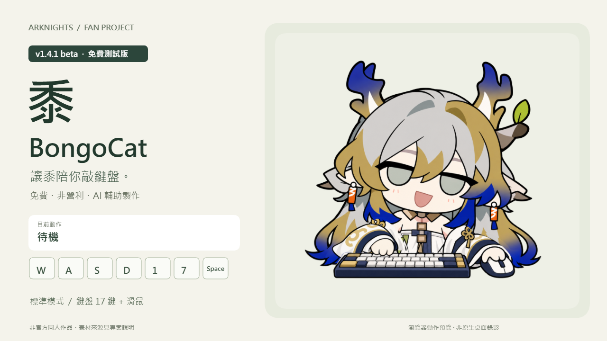

# 黍 · BongoCat

**v1.4.1 beta｜免費、非營利｜AI 輔助製作｜Beta 測試版**

讓黍陪你敲鍵盤。



《明日方舟》黍的非官方 BongoCat 標準模式皮膚。
提供半瞇眼表情、17 張鍵盤手勢與滑鼠跟隨／點擊動作。
本版供免費測試與回饋；手臂接合、遮擋和原生桌面互動仍有待確認的部分。


[24 秒 MP4 示範](demo.mp4) · [安裝步驟](INSTALL-zh-TW.md) · [已知限制](KNOWN-ISSUES.md) · [素材來源與 AI 製作說明](CREDITS.md)

影片與 GIF 取自本版的瀏覽器渲染預覽，並非原生桌面錄影。

## 下載與安裝

[下載模型與可編輯來源 ZIP](https://github.com/ice582/Shu-BongoCat/releases/download/v1.4.1-beta/Shu-BongoCat-v1.4.1-beta.zip) · [全部版本](https://github.com/ice582/Shu-BongoCat/releases)
先安裝 [ayangweb/BongoCat](https://github.com/ayangweb/BongoCat/releases)，解壓模型包，
在模型庫匯入直接包含 `cat.model3.json` 的資料夾，並啟用標準模式。
關閉「顯示所有按鍵圖」，使用同側最後按鍵模式。詳細步驟見安裝文件。

不要把 ZIP 直接交給 BongoCat 2.3.1 的資料夾選擇器。

## 支援按鍵

| 類別 | 按鍵 |
| --- | --- |
| 數字 | 1–7 |
| 字母 | Q、W、E、R、A、S、D |
| 功能鍵 | Shift、Ctrl、Space |
| 滑鼠 | 游標位置、左鍵、右鍵 |

本版沿用 v1.4.1 的圖像與動作，沒有套用後續版本的手臂修改。
表情固定半瞇眼；尚未提供手柄專用姿勢。

## 測試與回報

本機 Windows 10／BongoCat 2.3.1 已安裝、啟用與通過五秒啟動檢查。
瀏覽器預覽已檢查 17 張鍵圖與滑鼠參數；原生桌面完整按鍵效果仍待逐項確認。
完整範圍見 [已知限制與驗證](KNOWN-ISSUES.md)。
回報時請附 BongoCat 版本、作業系統、螢幕縮放、觸發按鍵及能看清問題的截圖或短片。

## 可編輯來源

完整模型與可編輯來源隨 Release 的 ZIP 提供。解壓後，`source-layers/` 為分層 PNG，`build-source/` 為 MOC3 與按鍵圖產生程式。
不包含 Cubism Editor CMO3 工程。可在備份後重建：

```sh
# 先進入下載的模型 ZIP 解壓資料夾
python build-source/build.py
npm install --no-save sharp
node build-source/render-keyposes.cjs
```

重建會覆寫模型檔及按鍵圖；原始分層與影像生成提示詞一併附上。
第三方程式的授權文字保留在 模型 ZIP 的 `LICENSE-*.txt`；角色與參考美術的權利另計。
